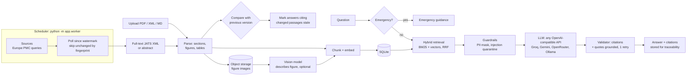

# Medical Helpline

A FastAPI backend that keeps a knowledge base of medical literature up to date by itself and
answers questions from it with verified citations.

- A **scheduler** polls literature sources (Europe PMC: PubMed, PubMed Central full text and
  preprints) every 24 hours and ingests new or revised articles.
- **Ingestion** parses full-text XML, PDFs and Markdown into a section tree, including
  **figures** (the image is kept in object storage, and a local vision model can describe it) and
  **tables** (kept as Markdown). Everything is chunked and embedded.
- **Answers** come only from retrieved passages. Every citation and quote is checked against the
  text the model saw. Each answer is stored with what it cited, so it is **marked stale when a
  cited article is revised or retracted**.
- **Safety**: emergency messages get emergency guidance instead of a literature answer, personal
  data is masked, and passages that try prompt injection are quarantined.

Everything is free: SQLite, a folder for object storage, fastembed for embeddings, and any
OpenAI-compatible language model API: a free online key (Groq, Google Gemini, OpenRouter) or
Ollama on your own computer. No paid service is needed.

## Architecture



## Setup (Windows, macOS or Linux)

```bash
uv lock && uv sync --extra dev --extra embeddings     # or: pip install -e ".[dev,embeddings]"
cp .env.example .env
```

Language model: pick one preset in `.env` (all free) and paste your key.

| Provider | Free key | Answers (`LLM_MODEL`) | Figures (`VISION_MODEL`) |
| --- | --- | --- | --- |
| Groq | [console.groq.com/keys](https://console.groq.com/keys) | `llama-3.3-70b-versatile` | `meta-llama/llama-4-scout-17b-16e-instruct` |
| Google Gemini | [aistudio.google.com/apikey](https://aistudio.google.com/apikey) | `gemini-2.5-flash` | `gemini-2.5-flash` |
| OpenRouter | [openrouter.ai/keys](https://openrouter.ai/keys) | any model ending in `:free` | an image-capable `:free` model |
| Ollama (offline) | none | `qwen2.5:3b` (fits a 4 GB GPU) | `qwen2.5vl:3b` |

Model names change over time: if you get "model not found", pick a current one from the
provider's model list. Answers and figures can use different providers (`VISION_BASE_URL`,
`VISION_API_KEY`). Free tiers rate-limit: the client retries with growing waits, and at most
`VISION_MAX_FIGURES_PER_ARTICLE` figures per article are sent to the vision model.
Questions are sent to the provider with personal data masked first.

No key yet? Set `LLM_PROVIDER=mock` to try everything with a deterministic offline stand-in.

## Run

Two terminals:

```bash
uv run uvicorn app.main:app --reload    # API: http://localhost:8000/docs
uv run python -m app.worker             # scheduler: polls every source that is due
```

`python -m app.worker --once` polls once and exits, if you prefer Windows Task Scheduler or cron.
The database starts empty. Four starter sources are created on first start (`app/sources/defaults.py`).

```bash
# Add your own candidate source (Europe PMC query syntax: https://europepmc.org/searchsyntax)
curl -X POST localhost:8000/sources -H "content-type: application/json" \
     -d '{"name": "Dengue", "query": "TITLE_ABS:(dengue AND (treatment OR management))"}'
curl -X POST localhost:8000/sources/1/poll                 # poll now instead of waiting
curl localhost:8000/ingestion-runs                          # what each poll found

# Search and ingest right away (the on-demand agent will use this)
curl -X POST localhost:8000/literature/search -H "content-type: application/json" \
     -d '{"query": "TITLE_ABS:(Oropouche AND treatment)", "limit": 5}'

# Upload a guideline PDF by hand
curl -F title="WHO dengue guideline" -F file=@guideline.pdf localhost:8000/articles/upload

# Ask
curl -X POST localhost:8000/ask -H "content-type: application/json" \
     -d '{"question": "How is severe dengue managed?"}'
```

## API

| Endpoint | Purpose |
| --- | --- |
| `POST /ask` | Answer with citations (`S1`, `S2`… mapped to article, section, DOI, figure URL), or emergency guidance. `needs_literature_search: true` when nothing relevant is stored |
| `POST /agent` | Tool-using agent with a step trace |
| `GET /answers?status=stale` | Past answers whose sources were revised or retracted |
| `GET/POST/PATCH /sources`, `POST /sources/{id}/poll` | Literature source registry |
| `POST /literature/search` | Search Europe PMC now and ingest the top results |
| `GET /ingestion-runs` | Poll history: found, new, updated, unchanged, failed, errors |
| `GET /articles`, `/articles/{id}`, `/tree`, `/versions`, `/diff` | Knowledge base and version history |
| `POST /articles/upload`, `POST /articles/{id}/retract` | Manual upload; manual retraction |
| `GET /objects/{key}` | Stored figure images and uploaded files |

## How each part works

| Stage | How it works | Code |
| --- | --- | --- |
| Sources | Europe PMC (free, no key) covers PubMed abstracts, PMC open-access full text and preprints. Polls oldest-first from a watermark date, so a poll capped at `MAX_ARTICLES_PER_POLL` resumes where it stopped. A known article is re-fetched only when Europe PMC's record dates change. Transient errors (429/5xx/timeouts) are retried with backoff | `app/sources/`, `app/services/source_service.py` |
| Scheduler | APScheduler process. Each source has its own interval (default 24 h). Every poll is logged as an `IngestionRun` | `app/worker.py` |
| Parsing | JATS XML: sections, abstract, lists, figures (label, caption, image file), tables (to Markdown), back matter skipped. PDF: headings from fonts, images with their "Figure N" captions, tables via PyMuPDF. OCR fallback for scanned pages | `app/parsers/` |
| Figures | Stored when the licence allows (Creative Commons / public domain, or uploads). With `VISION_MODEL` set, a local vision model describes each figure, and the description is added to its search text | `app/llm/vision.py`, `app/storage.py` |
| Versioning | Nodes hashed and matched across versions. Section added or removed = MAJOR, content changed = MINOR, cosmetic = PATCH. A changed number or negation always counts as a real change | `app/versioning/` |
| Traceability | Each answer stores the hash of every passage it cited. A new version that changes one, or a retraction, marks the answer stale with the reason | `app/services/staleness_service.py` |
| Retrieval | ~800-character chunks that never cross a heading; figures and tables are separate chunks. BM25 + cosine on `bge-small-en-v1.5`, merged with reciprocal rank fusion. The index is a numpy matrix cached in memory, rebuilt only when chunks change | `app/services/retrieval_service.py` |
| Generation | Short citation ids (`S1`…) for small local models. JSON output validated with Pydantic, then grounded: citations must be excerpts the model saw, and quotes must appear in them. One retry with the errors | `app/llm/` |
| Safety | Emergency patterns return emergency numbers (`EMERGENCY_NUMBER`, `MENTAL_HEALTH_HELPLINE`). PII masked before the LLM and in logs. Injected passages quarantined | `app/core/safety.py` |
| Evaluation | Exact checks: retrieval hit@3, citation, refusals, emergencies, injection, PII | `evals/` |

## Tests and evals

```bash
uv run pytest                                   # 48 tests, offline (mock LLM, fake Europe PMC server)
uv run python -m evals.run_evals                # against the model in .env
```

## Data and resets

There are no migrations: tables are created on start. After changing a model (`app/models/`),
delete the `data/` folder and start fresh. Also choose the embedding backend before ingesting:
chunks embedded by a different model are ignored, so switching means starting fresh too.

## Roadmap

1. ~~Clean-up, free local stack, article model~~
2. ~~Europe PMC connector, full-text parsing with figures and tables~~
3. ~~Scheduler, source registry, ingestion runs, revisions and retractions~~
4. ~~Multimodal: figure storage, vision descriptions, tables as Markdown~~ (not yet tested with a real vision model)
5. On-demand agent: when `/ask` finds nothing (`needs_literature_search`), check sufficiency,
   search the registered sources (`ingest_query`), ingest, answer
6. Judge agent: LLM-graded faithfulness, citation support and relevance for each answer, stored
   and exposed at `/metrics`, plus a medical evaluation set
7. Front end (chat page) and more safety checks

## Known limitations

- PDF heading detection uses font heuristics. Multi-column layouts can mis-order text, so JATS XML
  is preferred whenever Europe PMC has it.
- The relevance gate before answering is a simple score threshold. Step 5 replaces it with a real
  sufficiency check.
- Emergency and injection detection are pattern-based: a safety net, not triage.
- Europe PMC can be slow (one full-text request sometimes takes over a minute), so polls run in
  the background.
